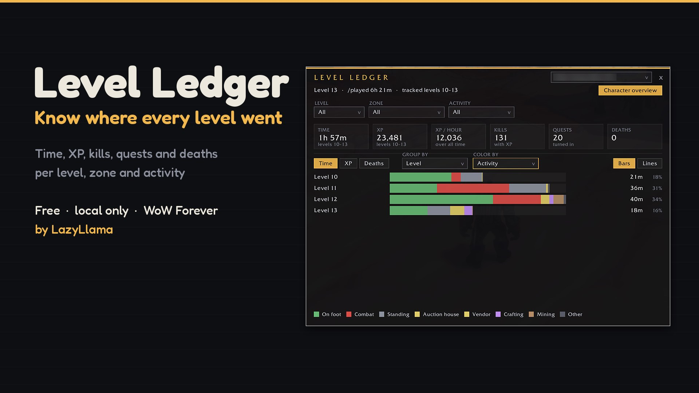
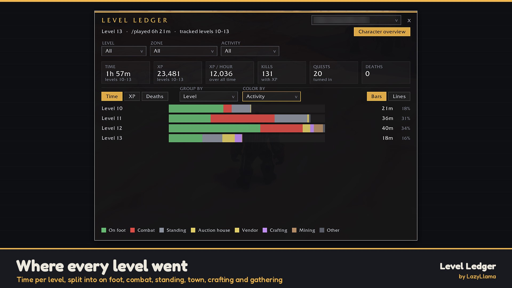
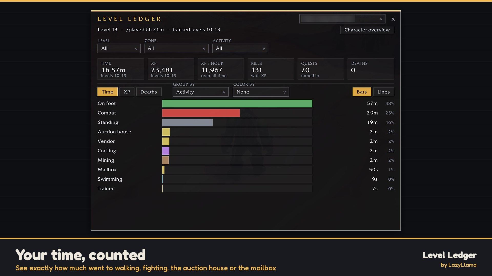
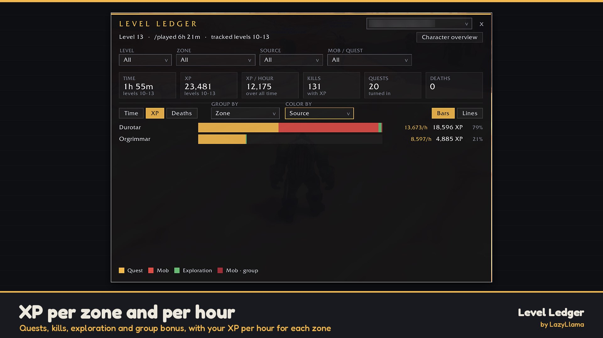
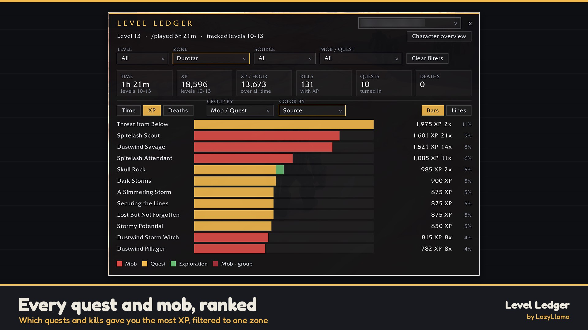
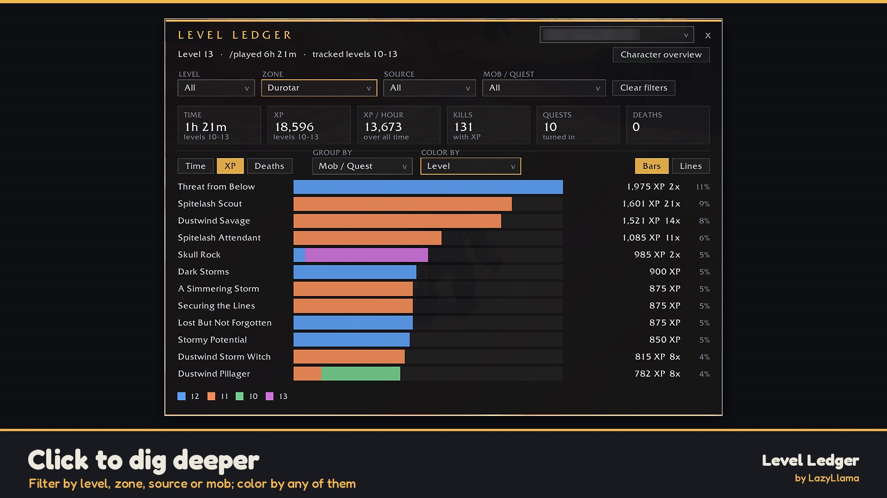

# Level Ledger

**Know where every level went.** Level Ledger is a free leveling dashboard for WoW Forever. It quietly counts your time, XP, kills, quests and deaths for every level and every zone, and shows it all in one clean window: how long each level took, where the time went, and which quests and mobs were worth it. All data stays on your PC.

## Features

### ⏱️ Time per level and zone
Every second you play is filed under your level, your zone and what you were doing: on foot, mounted, on a flight path, swimming, standing, in combat, AFK, or dead and running back as a ghost. Time in town is split into vendor, mailbox, auction house, bank, trainer and flight master. Crafting, mining, herbalism, skinning, fishing, eating and drinking get their own buckets too. Loading screens don't count.

### ✨ XP, broken down
- **Quests** by name, **mob kills** by mob, and **exploration** by area.
- Rested bonus and group bonus are shown apart from the base kill XP, so you can see what the bonus actually gave you.
- **XP per hour** for every level and zone, and for every mob and source based on the fights those kills happened in.

### 📊 One dashboard, many views
- Tiles at the top: time, XP, XP per hour, kills, quests turned in, deaths.
- **Bars** grouped by level, zone, activity, source or mob/quest, and colored by any other one.
- **Lines** across your levels, to see how leveling speed changes as you go.
- Click a bar or a level to filter to it and dig one step deeper. **Character overview** takes you back in one click.
- Switch between all your characters on the account from the dropdown at the top.

### 💀 Death recap
Every death is logged with level, zone and time. Open one to see the last 15 seconds of your health, the last hit, what you had targeted, and which long cooldowns and healing potions you **still had ready**.

### 🧭 Quiet by design
A small minimap button (drag it around the edge) and a few slash commands. Level Ledger checks `/played` in the background without spamming your chat, and it never sends anything to anyone.

## Screenshots

| | |
|---|---|
|  Time per level by activity |  Where your time went |
|  XP per zone and per hour |  Quests and mobs ranked by XP |
|  Filter and color by level | |

## Install
- **CurseForge app:** search for Level Ledger and choose your WoW Forever install.
- **Wago App:** search for Level Ledger and choose your WoW Forever install.
- **Manual:** download the zip from CurseForge or Wago and unzip it so the `LevelLedger` folder lands in `World of Warcraft\_classic_beta_\Interface\AddOns`.

Then log in and type `/ledger`, or click the pocket-watch button on the minimap.

## Commands
| Command | What it does |
|---|---|
| `/ledger`, `/levelledger` or `/ll` | Open or close the Level Ledger window |
| Minimap button | Click to open, drag to move it around the minimap |

## Community & feedback
- Discord: [discord.gg/EYEuYJxY4U](https://discord.gg/EYEuYJxY4U)
- Bugs & ideas: [GitHub Issues](https://github.com/LazyLlamaDev/LevelLedger/issues). Please include your addon version and any Lua error (BugSack/BugGrabber help).

## FAQ
**Level Ledger not showing in the CurseForge app?** Update the CurseForge app and pick your WoW Forever install.

**Does it know about levels I played before installing it?** No. It records from the moment you install it. Your total `/played` is still shown at the top.

**Does it work for all my characters?** Yes. Each character is tracked separately, and you can look at any of them from any character on the same account.

**Why doesn't the death recap name my killer?** Addons on this client can't read the combat log, so the recap is built from your own health changes. It shows the enemy you had targeted as a best guess.

**Does it send my data anywhere?** No. Everything is saved in your own SavedVariables and never leaves your PC.

**Was AI used?** Yes. The idea and design are mine; I used AI tools to help with code, text and some artwork, and I test every feature in-game myself.

## Version history
See [CHANGELOG.md](CHANGELOG.md).

## License
All Rights Reserved (see `LICENSE`). Source is published for transparency and personal inspection. Copying, modifying, redistributing, or reuploading without written permission is not allowed. Contact: [github.com/LazyLlamaDev](https://github.com/LazyLlamaDev).
World of Warcraft® and Blizzard Entertainment® are trademarks of Blizzard Entertainment, Inc. This is an independent community addon.
